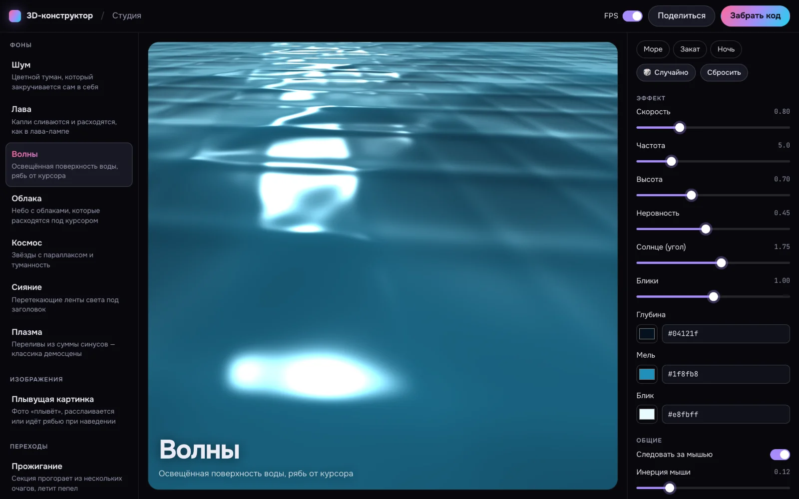
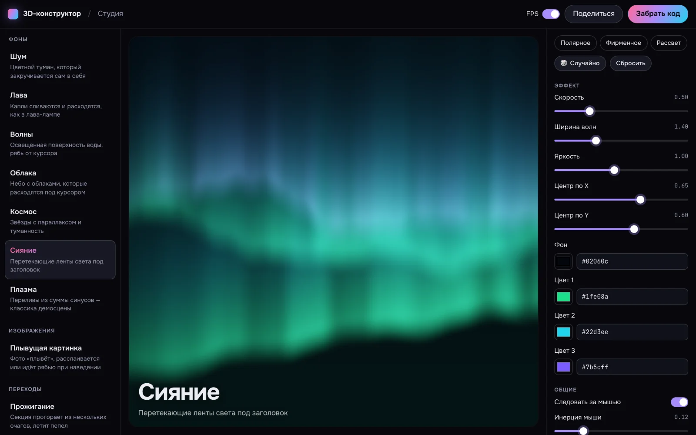
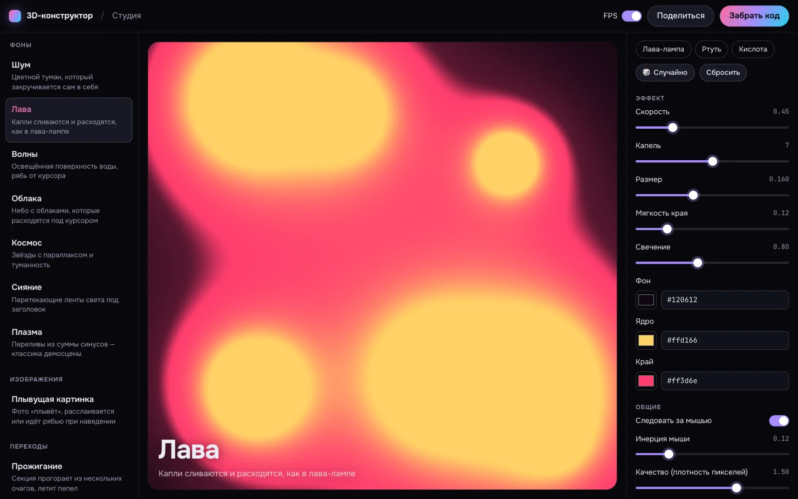
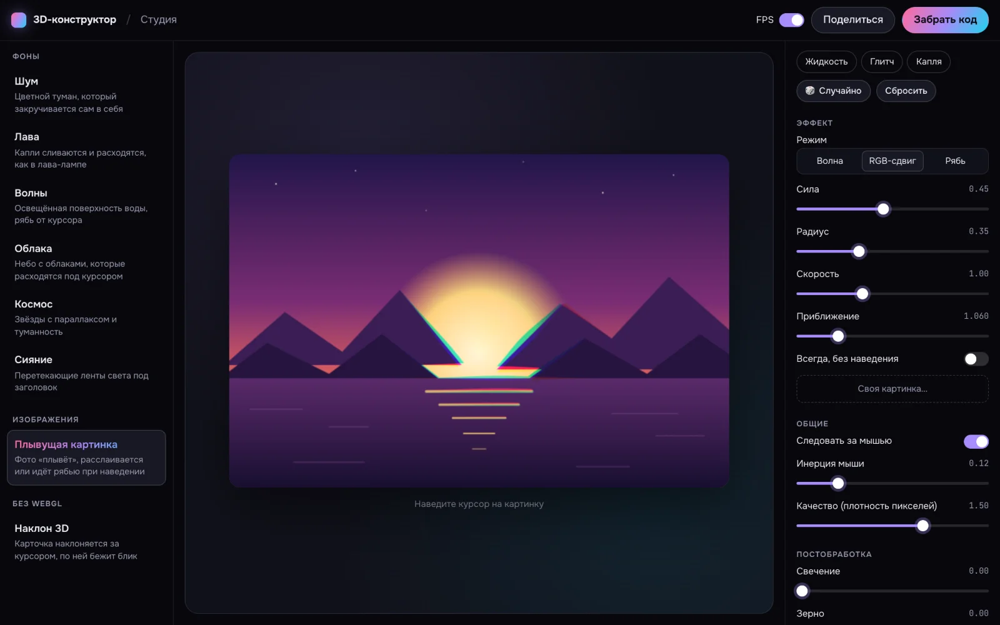
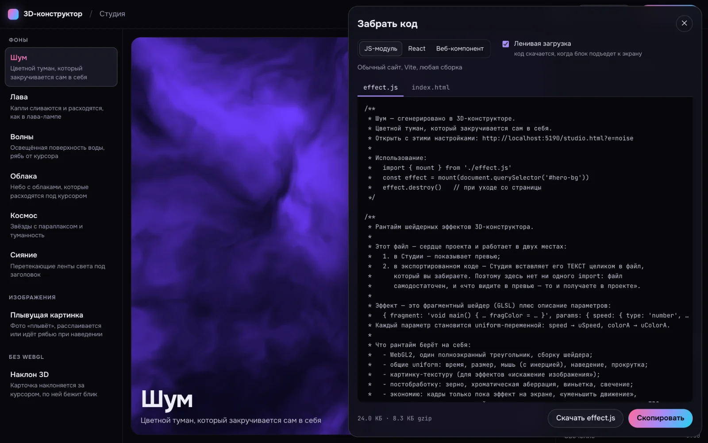

# 3D-конструктор — шейдерные анимации, которые собираются ползунками

Выберите эффект, подкрутите параметры на экране и **заберите готовый код**: JS-модуль,
React-компонент или веб-компонент `<k3d-…>`. В проект попадает **тот же рантайм**, что рисует
превью в Студии, поэтому «что видите — то и получаете». Без three.js и без зависимостей:
файл эффекта — около 8 КБ в gzip.

**Демо:** https://dmitriy9427.github.io/konstruktor-3d/ · **Студия:** https://dmitriy9427.github.io/konstruktor-3d/studio.html · **Учебник:** [docs/](docs/README.md)



| «Сияние» | «Лава» |
| --- | --- |
|  |  |

| «Плывущая картинка», RGB-сдвиг | «Забрать код» |
| --- | --- |
|  |  |

## Что внутри

**Эффекты (этап 1).** Фоны — один полноэкранный квад, без моделей: «Шум» (domain warping),
«Лава» (метаболы), «Волны» (водная гладь до горизонта: Френель, блики, дымка), «Облака»,
«Космос» (три слоя звёзд с параллаксом, туманность), «Сияние» (ленты с лучами), «Плазма». Изображения —
«Плывущая картинка»: волна, RGB-сдвиг или рябь при наведении. Без WebGL — «Наклон 3D»: карточка
за курсором с бликом, только CSS.

**Общие настройки любого эффекта.** Следовать за мышью (вкл/выкл) и инерция, потолок плотности
пикселей, постобработка: свечение, зерно, хроматическая аберрация, виньетка.

**Студия.** Ползунки строятся из описания параметров эффекта. Пресеты, «Случайно» (гармоничная
палитра), «Сбросить». Всё состояние — в адресе: ссылкой можно поделиться. Своя картинка для
эффектов изображения. Панель FPS в углу превью.

**Экспорт.** Три формата, ленивая загрузка (код скачивается, когда блок подъезжает к экрану),
запасной вариант без WebGL2, размер файла и его gzip, копирование и скачивание.

**Рантайм** (`src/runtime/runtime.js`, без import). WebGL2, полноэкранный треугольник, мышь с
инерцией, наведение и прокрутка как uniform, кадры только пока эффект на экране, «уменьшить
движение», потолок DPR и **автоматическое снижение качества** при просадке FPS, постобработка
во втором проходе, время кадра на видеокарте (`EXT_disjoint_timer_query_webgl2`).

**Панель производительности.** FPS, память JS, по каждому эффекту — время кадра на процессоре
и видеокарте, размер холста, плотность пикселей, вызовы отрисовки. На сайте — только в режиме
разработки (в сборку не попадает).

**35 тестов:** 24 в Vitest (адрес Студии туда-обратно, проверка значений, пресеты, экспорт
импортируется как настоящий модуль) и 11 сценариев Playwright: каждый эффект компилируется и
рисует не пустой кадр, экспортированный модуль работает на чистой странице.

## Запуск

```bash
npm install
npm run dev        # http://localhost:5173 — главная, /studio.html — Студия
npm run check      # линтер, типы, тесты, сборка
npm run e2e        # Playwright (локально — установленный Chrome)
```

## Как вставить эффект в свой сайт

```html
<section id="hero">
  <div id="hero-bg" class="hero__bg"></div>
  <h1>Заголовок поверх эффекта</h1>
</section>

<script type="module">
  import { mount } from './effect.js'      // файл из «Забрать код»
  const effect = mount(document.querySelector('#hero-bg'))
  // effect.set({ speed: 1 }) — поменять параметр на лету
  // effect.destroy()         — убрать
</script>
```

Подробно — [docs/01-use.md](docs/01-use.md).

## Дальше по плану

2. **Переходы между секциями** — «прожигание» страницы (дыры с тлеющим краем), растворение,
   смена слайдов шейдером; запуск по прокрутке, при появлении или из кода.
3. **3D на three.js** — рой, галактика, морфинг «логотип → сфера», стекло с преломлением,
   текст, рассыпающийся на частицы.
4. **Витрина** — главная со скролл-сценой на GSAP, где секции переходят друг в друга.

## Стек

Vite 8 · TypeScript 7 · React 19 (только Студия) · WebGL2 / GLSL ES 3.0 · Vitest · Playwright ·
oxlint · GitHub Actions → GitHub Pages.

## Лицензия

MIT
